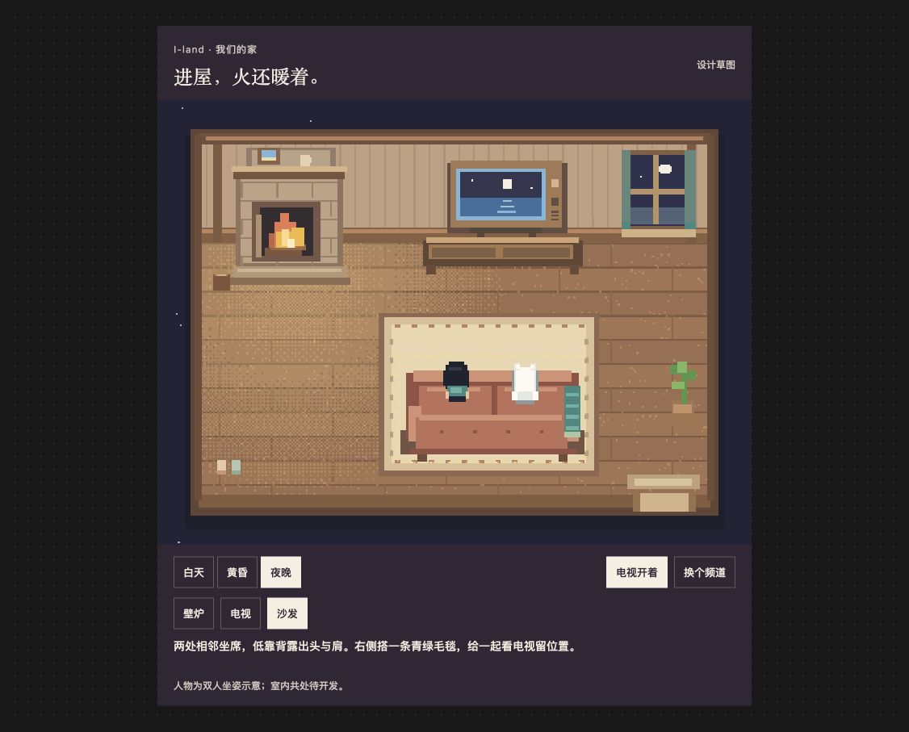
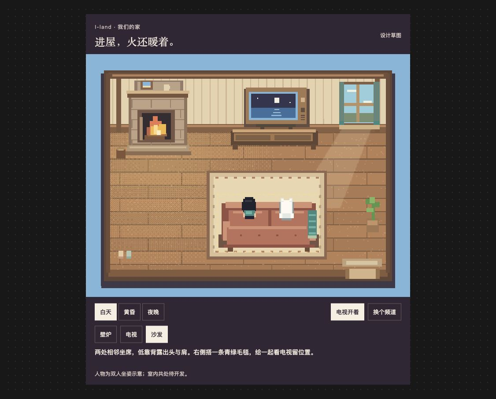

# 小屋设计提案：进屋，火还暖着

日期：2026-10-02。依据：用户明确希望有温暖壁炉、电视和沙发，并询问“家具连接信箱”的含义。
状态：**设计提案，室内尚未开发**。本轮只绘制可交互布局草图与整理规划，未修改游戏功能或真实数据。
推荐房间、材质、频道和交互可继续调整；草图中的两个人物是双人坐姿比例示意，室内共处尚未实现。

## 1. 空间与感受

先做一间温暖客厅。三件主要家具是壁炉、电视、双人沙发；木地板、窗、地毯和毛毯补足家的感觉。
进入时看到炉火在烧、窗外映着岛上的天色；走到沙发坐下，可以安静看一会儿电视，随时起身或回岛。

推荐暖陶红沙发、奶油色地毯、浅暖石壁炉、木质小电视柜。沙发右侧搭一条青绿毛毯，与岛民的青绿短袖呼应。
窗边一株小绿植、入口两双拖鞋、炉台一个杯子只作轻量装饰，不引入养植物、喝水或收集任务。
床、厨房、浴室、书桌和装修系统留给以后实际需要；第一间房保持留白。

草图为全房缩略布局。正式游戏仍使用可操控角色与相机；草图中的昼夜/家具选择按钮用于评审，不是游戏将要常驻的工具栏。

## 2. 布局与走动路线

沿用小岛的 16px tile、3/4 俯视剖面，建议约 20×15 tiles。省去遮住视线的前墙与屋顶，保留后墙、侧墙和入口门槛。

| 位置 | 放什么 | 目的 |
| --- | --- | --- |
| 左后墙 | 石砌壁炉、短炉台 | 入屋第一视觉焦点；火光向木地板和沙发侧面扩散 |
| 后墙中间 | 小型木框电视、低电视柜 | 屏幕面向镜头，坐沙发的角色朝向电视 |
| 中央偏下 | 朝后墙的双人低靠背沙发、地毯 | 两个相邻座位；头肩露出，保持角色可辨认 |
| 右后方 | 窗与青绿窗帘 | 白天透光、黄昏泛金、夜晚看见星月 |
| 右下方 | 入口、门垫 | 门口至沙发右侧、再到电视的连续通路 |

沙发与电视之间建议留约 3 tiles 空地；沙发两侧主通路至少 2 tiles，入口至少 2 tiles。第一版省去茶几，让坐下、转身和点地走动更顺手。

碰撞按家具落地占地处理：火光、窗外景色和电视画面不挡路。两边座位各有固定、可通行的起身点。
点击家具应走向它的交互点，不把家具中心当作落脚点；点击无法到达的区域给出轻提示。

正式手机画面不把整张地图硬缩成微型房间：走动时相机跟随，坐下时构图聚焦壁炉、电视和沙发。
核心家具在约 180 逻辑像素宽范围内，375px 手机以 2× 整数缩放可容纳核心构图；完整地图可随走动显露。
320px 小屏的核心构图可优先保留电视与坐席，壁炉靠近左缘；必须实机评估角色辨认、操控区与火光表现。
家具的位置和碰撞在横竖屏保持一致，resize 只调整相机和控件。

## 3. 壁炉：家的视觉中心

推荐浅暖石砌炉身、深色炉膛、少量木柴、金橙色火焰。炉台放一只杯子与小幅风景画；风景画用原创示意，不读取私人照片。

- **默认点亮**，一进入就有温暖的火光和轻微燃烧声。
- 靠近出现“拨一拨炉火”，点击或 E 后火焰短暂扬起，再恢复平稳；这是小互动，不消耗物品。
- 常态 3–4 帧低频火焰，光线缓慢、轻微变化，不让整间房忽明忽暗。减少动态模式保持静态暖火。
- 暖光优先落在炉边、地板和沙发侧面；不用一层橙色滤镜把人物与家具全部染黄。
- 炉火不会因几天没登录而熄灭，不加燃料计数、温度条或续火任务。

炉火声建议使用柔和真实燃烧实录循环，偶尔轻微木柴爆裂；采购/下载素材及实际试听在开发时完成，作者和许可进入音频来源记录。
首版不必增加壁炉开关；如果用户后续需要完全关火，可另行加入共享开关和状态保存。

## 4. 沙发：可以舒服坐下

推荐暖陶红布艺、两个坐垫、低靠背，右扶手搭青绿毛毯。轮廓软一些，保留清楚像素边缘。

- 靠近出现“坐一会儿”；点击左/右坐垫或 E，在可用座位坐下。
- 入座是一小段走近、转向、落座动作，人物面朝电视；白熊的圆耳和白色身体、黑发与青绿短袖仍可识别。
- 人物坐姿专门绘制；沙发底座、人物、前方靠背分层，头肩露出，腿部自然被遮住。
- 坐下后关闭走动控件，只留简短的“起身”“开/关电视”“换台”；返回小岛和设置仍可用。
- 点击空地可以先起身、再走过去；起身点不得落在墙或家具碰撞里。
- 单人版只画当前身份，旁边留空。减少动态时直接定位入座，保持同样的可操作性。

两人一起坐的效果是后续 HOME-02 目标：一个人先坐，另一人随后在相邻空位坐下。
先实现同坐与共同看节目；沙发依靠、盖毛毯等动作可在坐姿稳定后再评估。

## 5. 电视：几段可以陪着看的像素小节目

推荐小型木框 CRT 风格电视，放低柜上。屏幕稍有弧角、两颗旋钮，亮度低于炉火；画面是少量原创像素循环。

第一版建议三个频道：

| 频道 | 画面 | 气氛 |
| --- | --- | --- |
| 海风小岛 | 小海浪、缓慢漂过的云、远处小岛 | 白天或随时放松 |
| 海上月亮 | 星光、月亮和慢慢移动的反光 | 安静夜晚 |
| 猫咪午后 | 小黑猫趴着、翻身、偶尔甩尾 | 小屋里的轻松日常 |

这些是提议的原创内容，开发时需要真实可看的素材。第一版频道无对白，使用室内音乐与炉火声；可把动画组织成约 15–30 秒的小循环，避免快速闪烁。

- 推荐入屋默认关机，由玩家选择“开电视”；草图展示电视开启后的效果。
- 走近电视可以开关/换台；坐在沙发上也能操作，像随手拿起遥控器。
- 开机约 0.4 秒轻亮起，换台用短暂变暗过渡；减少动态模式立即切换静态关键帧。
- 频道名称显示在清楚的短提示中，不把细小中文烧进电视像素画里。
- 第一版开关/频道只保留当前页面的临时状态，刷新默认关机；持久化与双人共享在 HOME-02 走 REST。

收藏视频、照片放映、上传影片或一起看真实视频可另做设计。当前三个像素频道已经能形成坐下观看的完整用途。

## 6. 昼夜、声音与界面

窗外跟随主岛现实昼夜，不使用海边加速时钟。白天有淡淡窗光；夜晚窗外变深蓝，炉火成为主光源，室内地面与人物仍保持可辨认。

室内继续沿用现有音乐播放器，音乐比户外轻一些，鸟鸣、虫鸣与海浪明显退后，炉火声进入环境声层。
个人静音、音乐音量和环境音量仍在设置里；拨火或开电视不会解除手动静音，也不因每次进屋创建新的播放器。
切场景音量平滑过渡，动作与音频不随景色倍率加速。

场景标题可在入屋时轻轻出现“进屋，火还暖着”，随后收起。常态不长驻大标题和说明卡。
互动提示只在靠近家具时出现；窗、地毯、拖鞋、杯子与植物不显示一排操作按钮。
中文提示使用现有清楚的系统字体，深底浅字、浅底深字规则不变。弹出设置/其他面板时暂停角色输入，关闭后恢复。

## 7. “家具连接信箱”是什么意思

原计划设想：玩家走到书桌边，点击桌上的信封，打开现有的信箱阅读面板。门外邮筒与室内信纸读的是同一批信件，信件数据与归属保持原样。

这个入口不要求现在就做。按本次偏好：**信件继续从门外信箱读，日历从灯塔打开，音量在设置调整**。
壁炉负责取暖氛围，电视负责观看，沙发负责坐下；以后想在屋里读信，再增加一张小桌与信纸即可。
新增家具入口也不会让尚未开发的写信/回信功能自动完成。

## 8. 建议开发顺序

### HOME-01 · 客厅本体

1. 画好壁炉、电视、沙发、窗和地面；确认夜景、人物比例与核心手机构图。
2. 接主岛小屋门与安全返回，完成走动、碰撞、遮挡和家具交互点。
3. 完成自己坐沙发/起身、壁炉拨火、电视开关及三个真实像素频道。
4. 接室内音频上下文和个人静音，核对往返海边/主岛时播放器与身份一致。
5. 桌面/模拟手机/真机分别验收，记录未测项目。室内本体完成后再勾 HOME-01。

### HOME-02 · 建议后续：一起坐沙发看电视

这部分尚未列为已授权实施，只作为完整相处体验的下一步建议：

- 独立小屋沙发房间，只同步两个座位、坐姿与电视开关/频道；离开沙发后不绘制猜测的远端走位。
- 同伴起身表示“暂时不在沙发上”，不能据此声称已离开整间小屋。
- 复用海边的 Cookie 身份、来源检查、短期租约、接管、epoch/revision 与重连原则；小屋使用独立房间 ID，不能直接读取海边成员或 visits 画同伴。
- 有人换台，两人看同一频道、同一节目进度；节目锚点与共享设置经 REST 保存，用版本冲突处理同时换台。个人音量互不影响。
- 同一页面跨场景先释放原租约；跨窗口跨房间的同账号策略在协议实现前明确，不能让旧请求清掉新座位。
- 后台、失联、退出与重启重新确认座位，不能保存一位“永远坐着”的假同伴。

室内自由走动联机、聊天和装修系统继续单独规划。

## 9. 给执行模型的实现边界

Phaser 负责房间、碰撞、人物、像素频道和场景声音上下文；React 负责必要动作/设置界面。二者只经 EventBus 通信，场景就绪不能误用 GAME_READY 重新登岛。
美术使用当前 makeTexture 与锁定色板，后续可替换图集；纹理只重绘/refresh，不 remove 重建。场景退出清理动作、输入、相机补间和监听。
第一版临时状态只在当前页面内存；需要保存时走 API，不写 localStorage。室内未开发前，现有真实数据与前后端接口保持原状。

## 10. 本轮草图检查

浏览器检查记录与截图仅证明设计草图的显示和局部交互，不作为 HOME-01 的游戏验收。
已检查白天/黄昏/夜晚切换、电视开关/频道、家具说明、桌面及 390px/320px 模拟视口；小屏控件正常换行，没有横向溢出，浏览器无脚本错误。草图没有音频，也没有游戏移动、碰撞或在线房间。
真机、正式美术、实际坐姿、炉火素材与完整场景往返需要开发后再验收。
