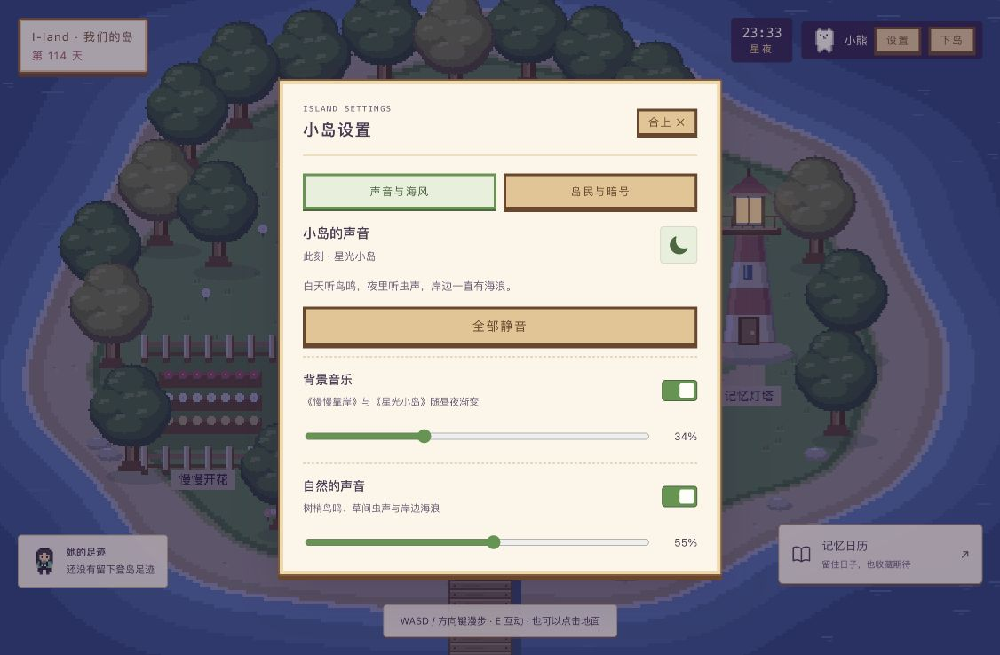
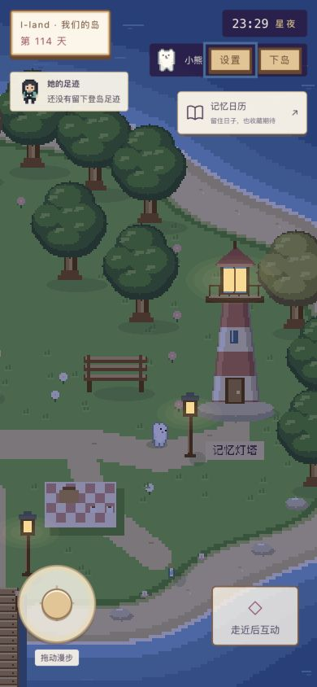

# SOUND-01 · 小岛昼夜音乐与环境声

日期：2026-10-01。开发起点 `main / c2c0097`。本地功能已实现；已按首轮反馈替换合成虫鸣，服务器未连接/更新，真机与后续主观听感反馈待补。

## 按最新反馈确定的体验

- 默认开启，主岛 HUD 没有音乐/音量按钮，控件集中在「设置 → 声音与海风」；「岛民与暗号」保留改名/改密功能。
- 浏览器允许时直接播放；拒绝自动播放时，第一次点击或输入同步恢复音频。登录页仅播放更轻的旋律，进入小岛不要求再点一次开启。设置里保留继续播放/加载重试。
- 日曲《慢慢靠岸》与夜曲《星光小岛》是同一主题的两种原创编配，80 BPM、16 小节、48 秒循环、相同和声。夜曲低八度、删减旋律、弱化高频。
- 两种编配同帧启动，无声一条也保留节拍位置；开关关闭后一起暂停，重开一起恢复。等功率分配日夜音量，以约 6–8 秒的平滑变化避免突切。
- 夜色权重跟随现实时间连续变化：17–20 点转入夜声，5:30–7:30 转回日声。白天鸟鸣，夜里虫鸣，黄昏/黎明渐变交接；海浪按海岸距离，鸟鸣/虫鸣按树林距离混音。
- 场景接口预留海边与室内：海边突出海浪、压低音乐，室内保留音乐且关闭户外声。独立场景尚未开发，未冒充完成。
- 隐藏暂停，前台仅恢复已获准且未手动关闭的声音。下岛停止环境声，登录页音乐延续；本页手动关闭的音乐/静音不因下岛被重开。

## 实现边界

- Phaser 唯一常驻 `AudioScene` 管理五条循环；React 只通过 EventBus 发个人设置与恢复请求，接收播放快照。
- 声音快照支持新监听者重新请求，避免登录切换时状态去重吞掉快照。shutdown 与直接 destroy 使用同一个幂等清理函数，释放总线/DOM/AudioContext 监听与声音对象。
- `UserPreference` 按不变 user_id 保存。现有 settings router 增加 GET/PUT `/api/settings/audio`，鉴权、禁止指定他人身份、0–1 有限音量、严格布尔和局部原子更新。GET 不写库，改名不换偏好。
- 滑杆立即调音，松手/键盘松键/关闭设置或 500ms 防抖保存；保存失败保留待提交字段，重试不 toggle。旧账号的取消请求不能修改新账号的保存状态。
- 打开 DOM 面板时 Phaser 释放全局按键捕获，避免拦截音量滑杆方向键；关闭恢复游戏输入。
- 没新增运行依赖，不写 localStorage。新表由现有 create_all 幂等创建，不改写旧信、记忆、附件或身份。

## 音频来源与资源

日曲、夜曲、鸟鸣与海浪由 `tools/generate_audio.py` 用标准库数学合成，无现成游戏曲目。
用户试听后指出原合成虫鸣像消息提示音，已移除短促合成音。夜间改用 sengjinn 的
[午夜蟋蟀野外实录](https://freesound.org/people/sengjinn/sounds/175020/)（CC0），保留自然虫群的连续变化。
源文件与校验和入库，`tools/prepare_insects.py` 温和滤波、裁切 58 秒、1.5 秒交叉融合及近零循环点处理；
新文件名 `night-insects.wav` 避免旧缓存。制作、作者与许可见 [SOURCES.md](../../../frontend/public/audio/SOURCES.md)。

| 音轨 | 秒 | 峰值 | RMS | 首尾相邻采样差 |
| --- | ---: | ---: | ---: | ---: |
| 日曲 | 48 | 0.55 | 0.116 | 0.00012 |
| 夜曲 | 48 | 0.42 | 0.085 | 0.00172 |
| 鸟鸣 | 26 | 0.32 | 0.045 | 0.00171 |
| 虫鸣实录 | 58 | 0.22 | 0.039 | 0.00015 |
| 海浪 | 28 | 0.55 | 0.076 | 0.00580 |

PCM 16-bit、22050 Hz、单声道，共 9.17 MB；登录异步加载两条音乐，登岛再加载环境声，不阻塞界面。
WAV 保留精确循环长度。后续可压缩资源，但须先验证编码填充、循环间隙与移动浏览器。
文件可实际试听，技术指标与成功调用播放不能替代人耳听感；本次未把“无明显点击声/满意听感”勾成已通过。

## 已执行验证

- 后端全套 **82 项通过**。新增 21 项覆盖鉴权、个人隔离、局部更新、严格开关/音量、非有限 JSON 值、0/1 边界、登出/改名后偏好保留及旧库重复启动。
- 声音 **9 项通过**：浏览器拒绝与首交互恢复、分层混音/连续夜色、鸟鸣退去/虫鸣接上、同步音乐暂停、后台/静音/反复登录、加载失败重试、迟到 resume、直接 destroy 清理、新 UI 快照。
- 日历回归 **10 项通过**。前端类型检查与生产构建通过；Phaser 大包提示保留，最终 JS 约 1.80 MB / gzip 422 KB。
- 本地浏览器临时库验证：主岛 HUD 无音量按钮；设置两分类可用；开关可操作并显示保存反馈；修正后键盘方向键将音乐从 35% 调到 34%；夜间五条循环已加载，可听层为 `nightMusic,crickets,waves`，没有鸟鸣。白天可听层为 `dayMusic,birds,waves`。
- 390×844 模拟窄屏可操作两条音量滑杆和开关，设置长内容可滚动；这是模拟视口，不能视为实际手机通过。
- 手动静音偏好在重新加载后保留，默认开启不会强行覆盖保存过的关闭选择。登录/前后台的生命周期还由替身测试覆盖；真实手机的系统锁屏、音频中断和具体听感仍待检查。
- 真实本地库升级前已用一致性快照备份数据库和 uploads：`backend/backups/iland-backup-20261001-225234`（忽略目录，不提交）。API/设置交互的验证使用 `/tmp/iland-sound-preview-20261001/`，真实记忆不充当测试数据。
- 2026-10-02 虫鸣替换后复核：前端构建与声音 9 项测试通过；58 个一秒片段的 RMS 为 0.0327–0.0425，无周期静音、无削波。两个本地预览服务提供的新 WAV 与源目录逐字节一致；重新加载后夜间实际播放层仍为 `nightMusic,crickets,waves`，浏览器没有声音加载错误。新素材的主观效果等待用户试听，不将数据指标当作满意听感。

## 交接

本地启动后打开「设置 → 声音与海风」即可调节；浏览器拦截时点击页面即可恢复，失败重试入口留在设置。
先试听两种旋律与环境声，微调音色/音量，再补实际 iOS Safari / Android Chrome、后台/锁屏及线上 HTTPS 验收。
下一开发包是 SCENE-01，其后 SEA-01。新场景发 AUDIO_CONTEXT，不能各自新建循环；景色倍率不得传给音频 rate。
