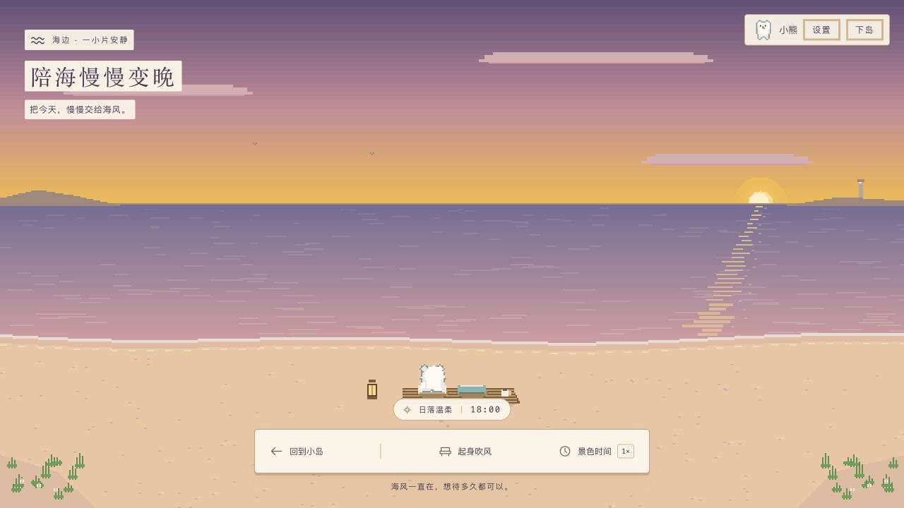
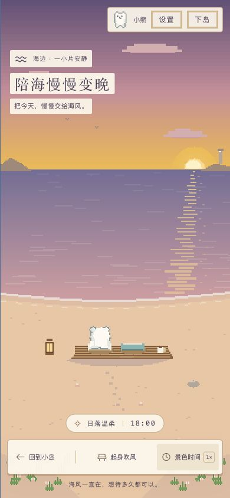
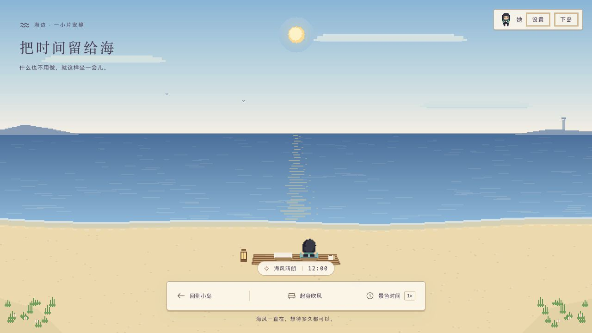

# SCENE-01 / SEA-01 · 海边的一小片安静

日期：2026-10-02。开发起点 `main / 4140ee2`。场景导航与单人看海本地实现；真实双人房间、小屋、真机与线上尚未完成。

## 画面与体验

- 从主岛俯视走岛切换到人物背对镜头的海天全景，给天空与远处海平线留大块空间。色板延续现有海蓝、奶油、沙色、桃金与暮色紫，晨光、白天、日落、星夜连续过渡。
- 太阳/月亮沿天空移动，光带伸到海面；疏细的远浪、较宽的近浪、湿沙和浪沫分出景深。远处保留岛影与一座小灯塔，夜空有很小的心形星座。
- 沙地中心是一小块木台和两处相邻坐垫，旁边有暖灯、杯子、贝壳与稀疏草叶。另一处留空，不用足迹或示例头像伪装实时同伴。
- 当前登录者沿短路径来到坐席；白熊有圆耳、白毛长身体，黑发岛民保留青绿短袖与黑裤。专门绘制背面坐姿与站姿，不能将旧站姿旋转/压扁代替。单人首版按固定身份选择左/右坐席，双人版接受服务端实际分配。
- 可以起身吹风、坐下、回岛；动作保持真实速度。海边隐藏漫步摇杆、主岛足迹与日历入口牌，账号/设置/下岛保留，中文使用正常可读字体。
- 景色时间平时收起；展开时桌面放右侧、手机放天空区域，避免挡住人物与坐席。控件包括暂停、1×、30×、120×、回到现实时间。设置仍统一控制声音。

美术位于 `game/art/seaside.ts`，复用 PixelArt → makeTexture 字符画管线，是原创程序像素画；没有下载第三方图片或改变正式 Tiled/图集仍待完成的事实。低分辨率画面使用整数倍缩放；resize 只原纹理刷新、裁切和重排，不 remove 纹理或重启场景。

## 导航与时钟边界

- Boot 启动常驻 Navigation/Audio，再进入 Login；视觉场景用 start/shutdown 切换。GAME_READY 仍只用于登录，SCENE_READY/SCENE_CHANGED 单独承担场景就绪与状态快照。
- ENTER_ISLAND 登录语义与 IDENTITY_CHANGED 更新身份分开；在海边改名不能被拉回主岛。导航保留身份副本和当前页面内返回点，快速双发旅行只接受一次，下岛优先取消旧相机补间和计时回调。
- 沙滩入口 `(360,376)` 距旧漂流瓶约 75 px；返回 `(360,338)`，距入口 38 px、在可走草地、不立即折返。入口木牌/坐垫/贝壳与漂流瓶区分；往返清空摇杆、按键、点地目标、提示与速度。
- `SceneryClock` 是可替换纯数据接口。LocalSceneryClock 以 UTC 锚点和单调时间推进、固定 Asia/Shanghai；变倍率保持连续，暂停或加速后切 1× 仅恢复正常流速，明确“回现实”才重置。重置的画面约 1.8 秒柔和衔接，减少动态直接重排。
- 当前临时时钟不持久化；再次进入/刷新重新从现实时间开始。ROOM-01 将提供共享 REST 锚点与 WS 快照，届时替换本地时钟，不复制这版内存状态作为同步协议。
- 虚拟时间只驱动海天颜色、太阳/月亮、反光及 AUDIO_CONTEXT 的昼夜；没有虚拟 DAY_TICK、全局 timeScale 或音频 rate 修改。日历、心跳、会话、恋爱天数继续使用真实时间。
- 音频仍由唯一 AudioScene 管理。海边降低音乐、突出海浪，昼夜环境自然交接；不会在 Seaside 新建播放器。React 只通过 EventBus 请求动作/时钟并接收快照。
- 面板打开阻止海边动作/调速并释放键盘；关闭只恢复海边交互。shutdown/destroy 共用幂等清理，解绑总线、resize、blur、媒体偏好、键盘与入座补间；旅行开始后迟到补间/偏好变化不能重新入座。

## 已执行验证

- 前端类型检查与生产构建通过；JS 约 1.82 MB / gzip 431 KB，仍有既有 Phaser 大包提示；声音资源独立异步加载。
- 前端 **41 项全部通过**：声音 9、日历 10、导航 5、景色时钟 10、海边生命周期 7。可运行 `node --test tests/*.test.mjs`；新场景单独入口 `npm run test:scenes`。
- 时钟覆盖连续改速、暂停、跨午夜、正常 1× 与现实重置的区别、四种系统时区、长后台与非法输入；生命周期覆盖快速旅行/退出抢先、迟到场景就绪/入座、身份变化、面板、resize、减少动态和同实例重复进入的清理。
- 本地浏览器使用命名临时库 `/tmp/iland-sound-preview-20261001/`；不会将真实记忆用于交互测试，本轮未修改后端表/API或真实数据库。
- 实际检查沙滩入口、入座/起身/坐下、海边设置内方向键调音量后恢复原值、返回草地安全点、重新进入。返回后 HUD 是现实 `00:46`，日历是 `2026-10-02`，没有沿用海边暂停的 `18:05`。
- 通过隔离 Cookie 的两个本地地址分别登录两位测试身份：白熊坐左侧，黑发青绿短袖的岛民坐右侧，另一席始终空着；后者返回仍保持自身身份。白天海边播放白天音乐与海浪。这是各自的单人场景，尚未同步为双人房间。
- 日历面板正常打开并显示真实日期；设置开关/滑杆布局正常。身份/纹理/导航自动测试通过；没有修改真实密码或拿真实旧信做破坏性测试。
- 390×844 模拟竖屏保留人物、坐席与海面，时间面板避开人物；模拟视口不等同真实 iOS/Android 验收。

## 下一包

ROOM-01 先落实真实 Cookie 身份、REST 加入/姿势/时钟、WS 快照、租约/接管/失联清理与共享持久化时钟；SEA-02 再画真实双人先后入座、依靠与断线状态。不能仅因两个窗口各自能看海就宣布双人同步完成。

HOME-01 可以复用 Navigation/Audio 提前做室内美术与本地漫步；实际手机、线上 HTTPS/WSS、减少动态系统设置、后台/锁屏与真实内容升级回归继续按 EXP-QA 验收。本轮没有连接或更新服务器。
