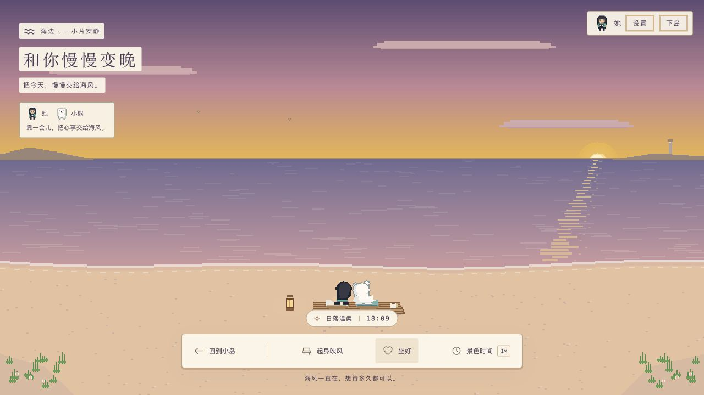
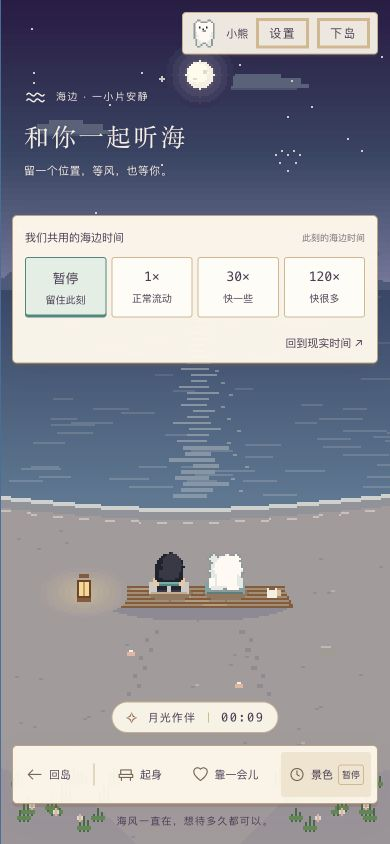
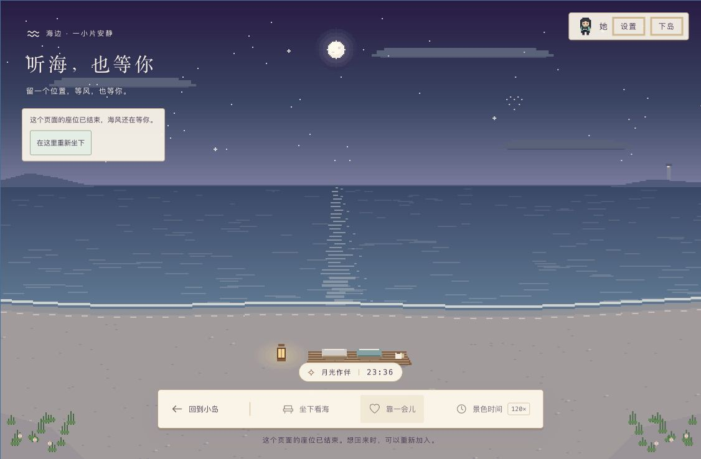

# 双人看海与共享景色时间 · 本地验收

执行：2026-10-02。起点：`main` / `f59e7dc`，继单人 SEA-01 后完成 ROOM-01 / SEA-02。
本轮没有连接或更新线上服务器；真实数据库与上传目录未用于联机测试。

## 交付行为

- 两位岛民进入同一个海边房间，先到者坐左侧，后来者坐另一侧；改名仍是原来的身份。
- 坐着、起身、向同伴轻靠、结束依靠均从服务器确认后显示；各自控制自己的姿势。
- 依靠有专门绘制的背面像素帧和过渡帧。单方、双方依靠的位置分别处理；另一位起身或离开后解除依靠。
- 暂停、1×、30×、120×及回到现实时间由两人共享。时区固定上海；1×恢复流速，明确重置才恢复现实时间。
- 日出日落、天空和反光使用共享时钟；恢复现实时间时柔和过渡。音乐、角色动作、真实日期、会话与心跳保持正常速度。
- 断线时移除尚未确认的成员，明确提示并禁用共享操作，保留看海与返回。自动重连重新验证身份和完整状态。
- 同账号新页面明确进入可接管；旧页面停止控制，需要点击“在这里重新坐下”才能重新加入。
- 桌面保留完整文字；手机显示回岛/起身/依靠/景色，展开时间选项放在天空区域。

## 实现与部署边界

`RoomClock` 在 SQLite 保存锚点、倍率和版本，经 REST 修改；并发旧版本返回冲突与最新快照。无人时和重启后仍按锚点推导景色，不逐帧写库。

成员、座位、姿势在单进程内存中，10 秒真实时间心跳、30 秒租约、2 秒清理检查。重启不恢复虚假的在线成员。页面隐藏主动释放座位，回来重新加入；锁屏后不能承诺继续陪坐。

房间动作走鉴权 REST，WS 只读推送完整快照。使用 Cookie 会话、来源校验、固定身份键、租约 ID、连接代数及 epoch/revision，拒绝第三身份、越权租约、旧请求和旧连接清理新座位。加入时校验预期身份并再次检查响应，避免同一浏览器换号后旧页面误占另一人的位置。

客户端以服务器 UTC、网络往返估计和单调时间推进；旧快照丢弃，小幅修正平滑处理。页面/场景代数隔离迟到请求和回调。React / Phaser 仍只通过 EventBus 通信，声音播放器仍只有原 AudioScene 一处。

首版只支持一个 Uvicorn worker、一个应用实例；主岛仍为 visits 异步足迹。小屋室内、自由走动联机未实现。发布核对见 [运维手册 §8](../../OPERATIONS.md#8-双人海边发布)。

## 自动检查

| 检查 | 结果 | 范围 |
| --- | --- | --- |
| 后端完整 pytest | **118 项通过** | 原有内容/设置/认证回归及 36 项房间权限、来源、座位、租约、依靠、并发、时钟、重启/会话测试 |
| 前端测试 | **70 项通过** | 声音 9、日历 10、导航 5、本地时钟 10、房间/共享时钟 24、海边生命周期 12 |
| 类型检查与生产构建 | **通过** | 保留 Terser；JS 约 1.84 MB / gzip 437 KB，仍有 Phaser 大包提示 |

房间测试包含设备墙钟偏移、网络往返、版本/epoch 排序、隐藏/重连、取消加入后补偿离开、同账号接管、Cookie 换号、旧 WS finally、延迟快照和场景重新进入。减少动态与动画并发由生命周期测试覆盖；不把替身测试当作真实设备验收。

## 浏览器验证

同一临时服务分别通过 `localhost:8021` 和 `127.0.0.1:8021` 登录小熊与她，隔离 Cookie；数据保存在 `/tmp/iland-seaside-room-20261002/`。未使用真实信件、照片或真实账号密码进行验证。

| 操作 | 实际结果 |
| --- | --- |
| 她先进入、小熊后来进入 | 她为座位 0，小熊为座位 1，两边成员一致；单人时留空位且不能依靠 |
| 小熊依靠、她随后依靠 | 另一边收到确认姿势，双方专门像素帧可见；一次本地前台动作到另一边 DOM 更新约 **287 ms**，不代表所有网络延迟 |
| 同伴起身 | 另一方从依靠恢复坐姿，依靠按钮禁用；重新坐下后可再次依靠 |
| 同账号第三窗口进入 | 旧页提示座位结束、清空成员并禁用操作；新页离开后旧页仍不自动抢占，显式重新入座可恢复 |
| 一方暂停 | 两边倍率为 0，虚拟毫秒完全相同，显示 00:09 |
| 临时服务停机/重启 | 停机显示重新连接、成员清空、共享操作禁用；重启后她的页面自动加入，暂停时刻与倍率原样恢复。另一页期间主动回岛，因此本次实际重启记录只证明单页自动恢复 |
| 回到现实时间 | 两边恢复 1×；显示“跟着此刻 · 上海时间”，重置按钮禁用；画面平滑回到当前黄昏 |
| 390×844 视口 | 两位角色、姓名和四个操作清楚可见；展开时间控件放在天空，不遮挡人物 |

## 尚未验证与下一包

- 实际 iOS / Android 的音频解锁、锁屏、触屏、系统减少动态及弱网；本轮手机证据是浏览器视口模拟。
- 线上 HTTPS/WSS、反向代理、Cookie、单实例配置和升级回退；本地 WS 成功不等于部署验收。
- 本轮浏览器使用点击海边提示进入；真实键盘入口未增加验收结论。改名/改密/换号/会话过期以自动测试为证，不宣称全部完成真人浏览器旅程。
- 保留既有恢复工具完整性检查缺口，发布前在 EXP-QA 收口。没有清理、删除或覆盖真实记忆。

下一开发包为 **HOME-01**：一间可走动的暖灯小屋，桌面打开已有信箱、照片墙打开日历、收音机打开声音设置，门口安全返回。小屋首版继续只画当前岛民，室内联机另行安排。
